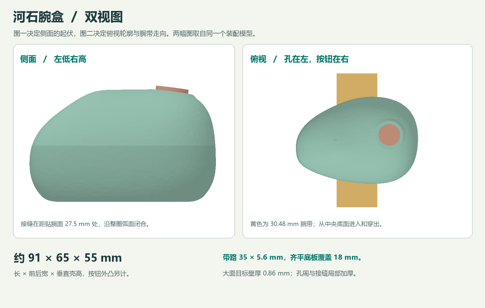
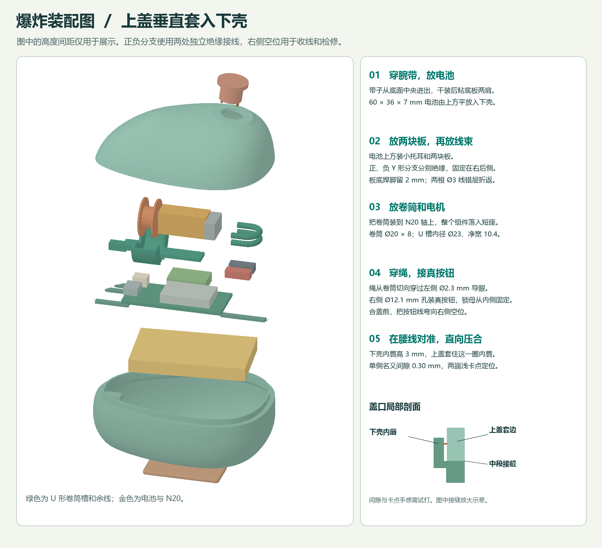

# 圆石腕盒 · 外形模型

三件 STL 的单位均为毫米，按 100% 导入。合盖后的壳体约 91 × 65 × 55 mm。此版用于检查外形、开合和穿带。电子部件在爆炸图中只作位置参考。

| 模型 | 用法 |
| --- | --- |
| [下壳](01-lower-shell.stl) | 套边朝上，底面中央为腕带通道。 |
| [上盖](02-upper-lid.stl) | 对准下壳套边后垂直合盖。左侧出绳孔 Ø2.3 mm，右侧按钮孔 Ø12.1 mm。 |
| [齐平底板](03-band-plate.stl) | 将腕带放入底面通道，试好松紧后再粘底板两肩。 |

如需在 CAD 中看合盖状态，按文件原点导入三个模型，保持下壳和底板就位，将上盖沿 Z 轴升高 27.5 mm。腕带通道净宽 35 mm，净高 5.6 mm，底板沿表带方向覆盖 18 mm。卡扣手感尚待实物试打。

